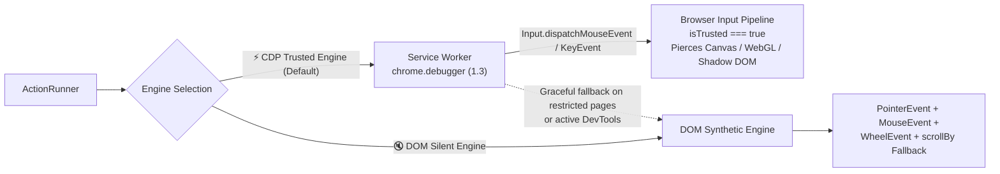

<div align="center">


# AutoClick Anywhere

**Universal Browser Auto-Clicker & Macro Recorder for DOM and Canvas / WebGL Apps (Manifest V3)**

[简体中文](./README.md) | **English**

[](./LICENSE)
[](./public/manifest.json)
[](https://github.com/littepointR/autoclick-anywhere/actions/workflows/ci.yml)
[](https://github.com/littepointR/autoclick-anywhere/releases)

</div>

---

**AutoClick Anywhere** is an open-source Chromium (**Chrome / Edge / Brave**) **Manifest V3** extension built to automate both **standard DOM pages** (including open Shadow DOM & moving elements) and **DOM-less Canvas / WebGL applications** (HTML5 games, Three.js, PixiJS, Unity WebGL, Cocos, interactive charts). It supports **single-point clicking, multi-point sequences, continuous/targeted scrolling, drag gestures, and macro recording/playback**.

---

## Key Features

### 1. Dual-Engine Input Dispatch



- **⚡ CDP Trusted Engine (Default, `chrome.debugger`)**
  - Dispatches native browser input commands (`Input.dispatchMouseEvent`, `Input.dispatchKeyEvent`) producing **`event.isTrusted === true`**.
  - Works directly on `<canvas>`, WebGL scenes, closed Shadow DOMs, and cross-origin iframes without needing DOM nodes inside the target area.
  - Automatically detaches the debugger when execution stops (`autoDetachDebugger`) and falls back gracefully to the DOM engine on restricted URLs (`chrome://`, `chrome-extension://`) or when DevTools is already open.
- **🔇 DOM Silent Engine**
  - Runs silently with zero debugger banner.
  - Fires properly ordered `pointerover` → `pointermove` → `pointerdown` → `mousedown` → `pointerup` → `mouseup` → `click` / `dblclick` / `contextmenu` events.
  - Dispatches `WheelEvent` to `<canvas>` or DOM elements and falls back to scrolling the nearest scrollable container (`scrollBy`) when not prevented.

### 2. Three-Mode Smart Target Locator (`TargetLocator`)

| Locator Mode | Best For | Behavior |
| :--- | :--- | :--- |
| **Canvas Relative (`canvas-relative`)** | Canvas/WebGL UI & games | Stores normalized coordinates `(relX, relY)` (`0.0 – 1.0`) inside the `<canvas>` bounding box so targets stay accurate even after window resize or scrolling. |
| **DOM Selector (`dom`)** | Standard & SPA elements | Generates resilient CSS selectors (crossing open Shadow DOMs via ` >>> `), tracks moving elements, and optionally scrolls off-screen targets into view. |
| **Viewport (`viewport`)** | Fixed screen coordinates | Targets fixed `(clientX, clientY)` viewport coordinates directly. |

### 3. Operation Modes

| Mode | Capabilities |
| :--- | :--- |
| **Single Point** | Pick any DOM/Canvas target or follow live cursor; left/right/middle click; single/double/hold; randomized timing (`±ms`) and position jitter (`±px`); finite or infinite repeat count. |
| **Multi-Point Sequence** | Chain Click, Scroll, Drag (`A → B`), and Wait nodes; drag numbered pin markers directly on the page to reposition; toggle/reorder steps and configure per-step repeats & loop delays. |
| **Scroll** | Continuous page-level or target-container/Canvas wheel scrolling (Down, Up, Left, Right, or custom `ΔX / ΔY`). |
| **Macro Record & Playback** | Captures clicks, drags (`>= 8px`), coalesced wheel bursts (`<= 120ms`), and keyboard events while ignoring the extension HUD; supports `0.5x – 10x` playback speed, macro management, and JSON import/export. |

---

## Installation

### Option 1: Pre-built Release (No Node.js Required)
1. Download **`autoclick-anywhere-v1.0.0.zip`** from [GitHub Releases](https://github.com/littepointR/autoclick-anywhere/releases) and extract it (the extracted folder contains `manifest.json` directly).
2. Open `chrome://extensions/` (Chrome) or `edge://extensions/` (Edge).
3. Enable **Developer mode**.
4. Click **Load unpacked** and select the extracted folder.

### Option 2: Build from Source
Requires **Node.js >= 23.6.0** (verified on v25.6.0):

```bash
git clone https://github.com/littepointR/autoclick-anywhere.git
cd autoclick-anywhere
npm install
npm run build
```

Then load the generated **`dist/`** directory via **Load unpacked**.

---

## Hotkeys

| Shortcut | Action |
| :--- | :--- |
| `F8` or `Alt+Shift+S` | Start / Stop active task |
| `F9` or `Alt+Shift+R` | Start / Stop macro recording |
| `Alt+H` or `Alt+Shift+H` | Show / Hide in-page HUD |
| `Escape` | Emergency stop / cancel target picker |

---

## Built-in DOM + Canvas + WebGL Test Playground

1. Click **"🧪 打开 DOM + Canvas + WebGL 测试靶场"** in the extension popup (uses the DOM engine automatically on `chrome-extension://` pages).
2. To test full **`CDP isTrusted=true`** input on localhost:
   ```bash
   npm run playground
   ```
   Open `http://127.0.0.1:4173/playground.html` in Chrome or Edge.

---

## Verification & Privacy

```bash
npm run typecheck   # Strict TypeScript check
npm test            # Automated unit & integration tests (12 tests)
npm run package     # Build dist/ and create release/autoclick-anywhere-v*.zip
```

- **100% Local**: All settings and recorded macros stay in local `chrome.storage.local`. No telemetry, analytics, or external network requests are made.
- **License**: [MIT](./LICENSE) · Contributions welcome via [CONTRIBUTING.md](./CONTRIBUTING.md).
