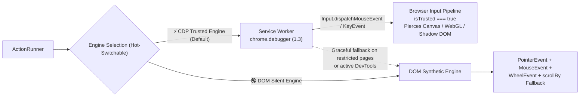

<div align="center">


# AutoClick Anywhere

**Visual Flowchart Auto-Clicker & Macro Recorder for DOM and Canvas / WebGL Apps (Manifest V3)**

[简体中文](./README.md) | **English**

[](./LICENSE)
[](./public/manifest.json)
[](https://github.com/littepointR/autoclick-anywhere/actions/workflows/ci.yml)
[](https://github.com/littepointR/autoclick-anywhere/releases)

</div>

---

**AutoClick Anywhere** is an open-source Chromium (**Chrome / Edge / Brave**) **Manifest V3** extension built to automate both **standard DOM pages** (including open Shadow DOM & moving elements) and **DOM-less Canvas / WebGL applications** (HTML5 games, Three.js, PixiJS, Unity WebGL, Cocos, interactive charts). It unifies clicking, scrolling, dragging, keystrokes, waiting, and macro recording into **composable visual Flowcharts**.

---

## Key Features (v1.1.0)

### 1. Dual-Engine Input Dispatch (Live Hot-Switchable)



- **⚡ CDP Trusted Engine (Default, `chrome.debugger`)**
  - Dispatches native browser input commands (`Input.dispatchMouseEvent`, `Input.dispatchKeyEvent`) producing **`event.isTrusted === true`**.
  - Works directly on `<canvas>`, WebGL scenes, closed Shadow DOMs, and cross-origin iframes; automatically detaches when paused/stopped (`autoDetachDebugger`) and falls back seamlessly on restricted URLs.
- **🔇 DOM Silent Engine**
  - Runs silently with zero debugger banner, firing full Pointer/Mouse/Wheel/Keyboard sequences with scrollable ancestor `scrollBy` fallback.

### 2. Visual Flowchart + Game Skill Cooldown UI + Pause/Resume vs Stop
- **Composable Step Nodes**: Chain **Click**, **Scroll (`wheel`)**, **Drag (`A → B`)**, **Keystroke**, and **Wait** steps in any order, plus 1-click presets (`+Single`, `+Scroll`, `+Blank`).
- **60fps Game Skill CD & Sub-Phase Pipeline**:
  - Every node displays a 44×44px Skill Icon Box with a **clockwise `conic-gradient` dark cooldown sweep + live countdown** during timed phases.
  - Sub-phase chips (`Pre-Delay`, `Action / Hold / Drag / Wait`, `Repeat Interval`, `Post-Cooldown`, `Loop Cooldown`) highlight the exact active stage with a sweeping shadow progress curtain.
- **Pause/Resume (`F8`) vs Stop (`Esc` / `Shift+F8`)**:
  - Pausing freezes the active countdown with exact `remainingMs` preserved, resuming right where it left off; stopping resets the flow cleanly to idle.

### 3. Macro-to-Flow Auto-Conversion & Precision UX
- **Macro Auto-Conversion**: Recorded clicks, drags (`>= 8px`), coalesced wheel events, and keystrokes automatically convert into an editable Flowchart upon stopping recording (`F9`), with `0.5x – 10x` playback speed and JSON import/export.
- **Per-Page Explicit HUD Visibility**: Hidden by default on webpages (`false`), only appearing on tabs where you explicitly click the popup toggle or press `Alt+H`.
- **1-Click Pin Toggle (`Alt+P`), Bulletproof Drag Shield & Adaptive Viewport Clamping**: Toggle placed target pins anytime; full-screen shadow drag shield + `setPointerCapture` prevents pins from dropping during fast mouse drags; expanding the HUD or toggling wide mode automatically shifts the console inside available viewport space.

### 4. Three-Mode Smart Target Locator (`TargetLocator`)

| Locator Mode | Best For | Behavior |
| :--- | :--- | :--- |
| **Canvas Relative (`canvas-relative`)** | Canvas/WebGL UI & games | Stores normalized `(relX, relY)` (`0.0 – 1.0`) inside `<canvas>` so targets remain accurate across resize/scroll. |
| **DOM Selector (`dom`)** | Standard & SPA elements | Generates resilient CSS selectors (crossing open Shadow DOM via ` >>> `) and scrolls off-screen targets into view. |
| **Viewport (`viewport`)** | Fixed screen coordinates | Targets fixed `(clientX, clientY)` viewport coordinates directly. |

---

## Installation

### Option 1: Pre-built Release (No Node.js Required)
1. Download **`autoclick-anywhere-v1.1.0.zip`** from [GitHub Releases](https://github.com/littepointR/autoclick-anywhere/releases) and extract it.
2. Open `chrome://extensions/` (Chrome) or `edge://extensions/` (Edge) and enable **Developer mode**.
3. Click **Load unpacked** and select the extracted folder.

### Option 2: Build from Source
Requires **Node.js >= 23.6.0** (verified on v25.6.0):

```bash
git clone https://github.com/littepointR/autoclick-anywhere.git
cd autoclick-anywhere
npm install
npm run package
```

Load **`dist/`** via **Load unpacked**; store ZIP & submission graphics are generated in **`release/`**.

---

## Hotkeys

| Shortcut | Action |
| :--- | :--- |
| `Alt+H` or `Alt+Shift+H` | Show / Hide floating HUD on the current page |
| `F8` or `Alt+Shift+S` | Start / Pause / Resume current flow |
| `Shift+F8` or `Escape` | Stop execution / finish recording / cancel picker |
| `F9` or `Alt+Shift+R` | Start / Stop macro recording (auto-converts to Flowchart) |
| `Alt+P` | Show / Hide placed target pins |

---

## Built-in DOM + Canvas + WebGL Test Playground

1. Click **"🧪 打开 DOM + Canvas + WebGL 测试靶场"** in the extension popup (uses the silent DOM engine automatically on `chrome-extension://` pages).
2. To test full **`CDP isTrusted=true`** input on localhost:
   ```bash
   npm run playground
   ```
   Open `http://127.0.0.1:4173/playground.html` and click the header button to open the HUD.

---

## Privacy, Store Submission & License

- **Privacy Policy**: 100% local execution, zero data collection — see [PRIVACY_POLICY.md](./PRIVACY_POLICY.md).
- **Store Publishing Guide**: Copy-paste store descriptions, permission justifications, graphic assets checklist, and CI secrets setup in [STORE_PUBLISH_GUIDE.md](./STORE_PUBLISH_GUIDE.md).
- **License**: [MIT](./LICENSE) · Contributions welcome via [CONTRIBUTING.md](./CONTRIBUTING.md).
