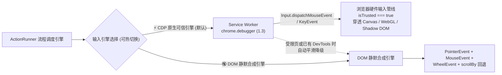

<div align="center">


# AutoClick Anywhere

**支持 DOM 与 Canvas / WebGL 无 DOM 应用的可视化流程图自动点击器与宏录制扩展 (Manifest V3)**

[](./LICENSE)
[](./public/manifest.json)
[](https://github.com/littepointR/autoclick-anywhere/actions/workflows/ci.yml)
[](https://github.com/littepointR/autoclick-anywhere/releases)

**简体中文** | [English](./README.en.md)

</div>

---

**AutoClick Anywhere** 是一款开源的 Chromium（Chrome / Edge / Brave）**Manifest V3** 浏览器插件。专为同时驾驭 **标准 DOM 网页**（含开放 Shadow DOM 与动态位移元素）和 **Canvas / WebGL 无 DOM 应用**（HTML5 游戏、Three.js、PixiJS、Unity WebGL、Cocos 等）而设计，将单点、多点、滚动、拖拽、按键与等待统一为 **可组合的可视化流程图（`FlowRecord`）**。

---

## 核心特性 (v1.2.0)

- **多语言界面与实时切换（v1.2.0 新增）**：内置 **简体中文 / 繁體中文 / English / 日本語 / 한국어** 5 种界面语言（支持浏览器语言自动适配 `auto`），覆盖原生 `_locales` 扩展名称与快捷键说明，以及悬浮控制台（HUD）、Popup 与测试靶场之间的毫秒级实时同步切换。

### 1. 双引擎输入派发架构（运行中支持即时热切换）



- **⚡ CDP 原生可信引擎（默认，基于 `chrome.debugger`）**
  - 通过浏览器底层 `Input.dispatchMouseEvent` / `Input.dispatchKeyEvent` 派发原生事件，生成 **`event.isTrusted === true`**。
  - 直接穿透 `<canvas>`、WebGL 画布、封闭 Shadow DOM 与跨域 iframe；暂停或停止后自动分离调试器（`autoDetachDebugger`），受限页面自动无缝降级为 DOM 引擎。
- **🔇 DOM 静默合成引擎**
  - 零调试横幅，静默运行，按标准顺序派发 Pointer/Mouse/Wheel/Keyboard 事件并支持最近可滚动容器 `scrollBy` 回退。

### 2. 可组合流程图 + 游戏技能 CD 阴影可视化 + 暂停 / 停止
- **可自由组合的步骤节点**：将 **点击（`click`）**、**滚动（`wheel`）**、**拖拽（`drag` A → B）**、**按键（`key`）** 与 **等待（`wait`）** 自由串联成流程图，同时提供「+单点」「+滚动」「+空白」一键预设。
- **技能 CD 旋转阴影与分环节高亮**：
  - 每个节点左侧拥有 44×44px 技能图标框，执行时间类阶段时以 60fps 展示顺时针旋转的 `conic-gradient` 深色冷却阴影与实时倒计时。
  - 节点内拆解展示各个执行环节（`前置等待` / `动作·长按·拖拽·等待` / `连点间隔` / `后置冷却` / `轮次冷却`），当前正在执行的环节会实时高亮并扫过横向阴影进度条。
- **区分暂停与停止**：
  - **⏸ 暂停（`F8`）**：精准冻结当前执行进度与计时器剩余毫秒数，允许查看/调整参数后从断点精确继续。
  - **⏹ 停止（`Esc` / `Shift+F8`）**：彻底终止任务并重置流程进度。

### 3. 宏录制自动转流程图 & 精准交互体验
- **宏录制自动转换**：录制点击、拖拽（`>= 8px`）、滚轮（`120ms` 内智能合并）与按键，结束录制后自动生成并展示为可编辑流程图（支持 `0.5x ~ 10x` 倍速与 JSON 导入导出）。
- **按页面显式开启（不全局打扰）**：默认在所有网页保持隐藏，仅在您通过工具栏弹窗点击或按 `Alt+H` 明确开启的当前网页才显示悬浮控制台。
- **一键显隐目标点（`Alt+P`）& 防脱手拖拽护盾**：支持一键显示/隐藏页面放置的数字目标点；拖动目标点或面板时启用全屏透明拖拽护盾 + `setPointerCapture`，高速甩动鼠标也不会脱手；展开面板时自动检测四周可用空间，防止控制台超出屏幕边缘。

### 4. 三模态智能目标定位（`TargetLocator`）

| 定位模式 | 适用场景 | 核心机制 |
| :--- | :--- | :--- |
| **Canvas / WebGL 相对比例** | 游戏画布、3D 场景、图表 | 记录归一化比例 `(relX, relY)`（`0.0 ~ 1.0`），窗口缩放或画布移动时依然准确命中内部像素位置。 |
| **DOM 选择器追踪** | 普通网页按钮、动态 SPA | 自动生成高稳定度 CSS 选择器（支持 ` >>> ` 穿透开放 Shadow DOM），元素移动后自动重新定位。 |
| **固定视口坐标** | 绝对屏幕位置点击 | 直接锁定视口坐标 `(clientX, clientY)`。 |

---

## 快速安装

### 方式一：下载预打包版本（无需 Node.js，推荐）
1. 前往 [GitHub Releases](https://github.com/littepointR/autoclick-anywhere/releases) 下载最新版本的 **`autoclick-anywhere-v1.2.0.zip`** 并解压到本地文件夹（目录内直接包含 `manifest.json`）。
2. 打开 Chrome（`chrome://extensions/`）或 Edge（`edge://extensions/`）。
3. 打开 **「开发人员模式 / Developer mode」** 开关。
4. 点击 **「加载已解压的扩展程序 / Load unpacked」**，选择刚刚解压出来的文件夹（或直接拖入页面）。

### 方式二：从源码构建
需要 **Node.js >= 23.6.0**（已在 Node v25.6.0 验证）：

```bash
git clone https://github.com/littepointR/autoclick-anywhere.git
cd autoclick-anywhere
npm install
npm run package
```

构建产物位于 **`dist/`**，商店上传压缩包与宣传视觉素材位于 **`release/`**。

---

## 快捷键说明

| 快捷键 | 功能 |
| :--- | :--- |
| `Alt+H` 或 `Alt+Shift+H` | 在当前网页显示 / 隐藏悬浮控制台 (HUD) |
| `F8` 或 `Alt+Shift+S` | 启动 / 暂停 / 继续当前流程图执行 |
| `Shift+F8` 或 `Escape` | 彻底停止执行 / 完成录制 / 取消拾取 |
| `F9` 或 `Alt+Shift+R` | 开始 / 完成宏录制并自动转为流程图 |
| `Alt+P` | 一键显示 / 隐藏页面放置的目标点标记 |

---

## 内置 DOM + Canvas + WebGL 测试靶场

1. **快捷预览**：点击扩展工具栏弹窗底部的 **「🧪 打开 DOM + Canvas + WebGL 测试靶场」**（注：浏览器安全策略禁止对 `chrome-extension://` 页面附加 `chrome.debugger`，此页会自动使用 DOM 静默引擎）。
2. **完整验证 `CDP isTrusted=true`**：在项目目录启动本地测试服务：
   ```bash
   npm run playground
   ```
   访问 `http://127.0.0.1:4173/playground.html`，点击顶部 **「在本页显示/隐藏悬浮面板 (Alt+H)」** 即可实测 `CDP 原生可信引擎` 与 `DOM 静默引擎`。

---

## 隐私政策、商店提审与开源协议

- **隐私政策**：100% 本地运行，零数据采集与上传，详见 [PRIVACY_POLICY.md](./PRIVACY_POLICY.md)。
- **商店提审指南**：Microsoft Edge Add-ons 与 Chrome Web Store 提审素材、审核说明与 CI Secrets 配置见 [STORE_PUBLISH_GUIDE.md](./STORE_PUBLISH_GUIDE.md)。
- **开源协议**：基于 [MIT License](./LICENSE) 开源，欢迎提交 [Issues](https://github.com/littepointR/autoclick-anywhere/issues) 与 PR（[CONTRIBUTING.md](./CONTRIBUTING.md)）。
