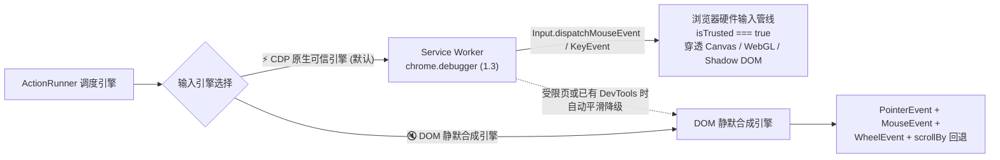

<div align="center">


# AutoClick Anywhere

**支持 DOM 与 Canvas / WebGL 无 DOM 应用的全能浏览器自动点击器与宏录制扩展 (Manifest V3)**

[](./LICENSE)
[](./public/manifest.json)
[](https://github.com/littepointR/autoclick-anywhere/actions/workflows/ci.yml)
[](https://github.com/littepointR/autoclick-anywhere/releases)

**简体中文** | [English](./README.en.md)

</div>

---

**AutoClick Anywhere** 是一款开源的 Chromium（Chrome / Edge / Brave）**Manifest V3** 浏览器插件。专为同时驾驭 **标准 DOM 网页**（含开放 Shadow DOM 与动态位移元素）和 **Canvas / WebGL 无 DOM 应用**（HTML5 游戏、Three.js、PixiJS、Unity WebGL、Cocos 等）而设计，提供 **单点、多点序列、滚动、拖拽、宏录制与倍速回放** 完整能力。

---

## 核心特性

### 1. 双引擎输入派发架构



- **⚡ CDP 原生可信引擎（默认，基于 `chrome.debugger`）**
  - 通过浏览器底层 `Input.dispatchMouseEvent` / `Input.dispatchKeyEvent` 派发原生事件，生成 **`event.isTrusted === true`**。
  - 无需 DOM 元素即可直接穿透 `<canvas>`、WebGL 画布、封闭 Shadow DOM 与跨域 iframe。
  - 任务停止自动断开调试器（`autoDetachDebugger`）；在受限页面（如 `chrome://`、`chrome-extension://`）或已打开 DevTools 时自动无缝降级为 DOM 引擎。
- **🔇 DOM 静默合成引擎**
  - 零调试横幅，静默运行。
  - 按标准顺序派发 `pointerover` → `pointermove` → `pointerdown` → `mousedown` → `pointerup` → `mouseup` → `click` / `dblclick` / `contextmenu`。
  - 支持 `WheelEvent` 滚轮事件派发，并在未阻止默认行为时自动查找最近的可滚动祖先容器执行 `scrollBy` 滚动。

### 2. 三模态智能目标定位（`TargetLocator`）

| 定位模式 | 适用场景 | 核心机制 |
| :--- | :--- | :--- |
| **Canvas / WebGL 相对比例** | 游戏画布、3D 场景、图表 | 自动记录画布内归一化比例 `(relX, relY)`（`0.0 ~ 1.0`），窗口缩放或画布移动时依然准确命中内部像素 UI 位置。 |
| **DOM 选择器追踪** | 普通网页按钮、动态 SPA | 自动生成高稳定度 CSS 选择器（支持 ` >>> ` 穿透开放 Shadow DOM），元素位置移动或滚动时自动重定位并滚动至可视区域。 |
| **固定视口坐标** | 绝对屏幕位置点击 | 直接锁定视口坐标 `(clientX, clientY)`。 |

### 3. 四大操作模式与交互体验

| 模式 | 功能亮点 |
| :--- | :--- |
| **单点模式** | 支持页面拾取目标或「跟随鼠标实时位置」；左/右/中键；单击/双击/长按；时间随机抖动（`±ms`）、坐标随机偏移（`±px`）、次数限制（`0=无限`）。 |
| **多点序列** | 自由编排「点击」「滚动」「拖拽轨迹（A → B）」「等待」节点；可在网页上直接拖动数字标记微调点位，支持步骤启停、上下排序、单步重复与整轮循环。 |
| **滚动模式** | 支持整页或指定容器 / Canvas 坐标连续滚轮操作（向下、向上、向左、向右、自定义 `ΔX / ΔY`）。 |
| **宏录制与回放** | 捕获点击、拖拽（自动识别 `>= 8px` 拖拽）、滚轮（`120ms` 内自动合并连续微滚动）与键盘按键，自动过滤插件自身悬浮窗操作；支持 `0.5x ~ 10x` 倍速回放、多脚本保存/重命名/删除与 JSON 导入导出。 |

---

## 快速安装

### 方式一：直接下载预打包发布版（无需 Node.js，推荐）
1. 前往 [GitHub Releases](https://github.com/littepointR/autoclick-anywhere/releases) 下载最新版本的 **`autoclick-anywhere-v1.0.0.zip`** 并解压到本地文件夹（目录内直接包含 `manifest.json`）。
2. 打开 Chrome（`chrome://extensions/`）或 Edge（`edge://extensions/`）。
3. 打开右上角 / 左侧边栏的 **「开发人员模式 / Developer mode」** 开关。
4. 点击 **「加载已解压的扩展程序 / Load unpacked」**，选择刚刚解压出来的文件夹（或直接拖入扩展管理页面）。

### 方式二：从源码构建
需要 **Node.js >= 23.6.0**（已在 Node v25.6.0 验证）：

```bash
git clone https://github.com/littepointR/autoclick-anywhere.git
cd autoclick-anywhere
npm install
npm run build
```

构建完成后，在浏览器扩展管理页加载项目下的 **`dist/`** 目录即可。

---

## 快捷键说明

| 快捷键 | 功能 |
| :--- | :--- |
| `F8` 或 `Alt+Shift+S` | 启动 / 停止当前模式执行 |
| `F9` 或 `Alt+Shift+R` | 开始 / 停止宏录制 |
| `Alt+H` 或 `Alt+Shift+H` | 显示 / 隐藏页面悬浮面板 (HUD) |
| `Escape` | 紧急停止执行 / 停止录制 / 取消目标拾取 |

---

## 内置 DOM + Canvas + WebGL 测试靶场

1. **快捷预览**：点击扩展工具栏弹窗底部的 **「🧪 打开 DOM + Canvas + WebGL 测试靶场」**（注：浏览器安全策略禁止对 `chrome-extension://` 页面附加 `chrome.debugger`，此页会自动使用 DOM 静默引擎）。
2. **完整验证 `CDP isTrusted=true`**：在项目目录启动本地测试服务：
   ```bash
   npm run playground
   ```
   然后访问 `http://127.0.0.1:4173/playground.html`，即可同时实测 `CDP 原生可信引擎 (isTrusted=true)` 与 `DOM 静默引擎` 在 DOM 动态移动靶心、局部滚动容器、2D Canvas 无 DOM 游戏按钮与能量球拖拽、以及 WebGL 3D 模型旋转缩放中的表现。

---

## 本地校验与测试

```bash
npm run typecheck   # TypeScript 严格类型检查
npm test            # 运行自动化单元与集成测试（12 项）
npm run package     # 生成图标、构建 dist/ 并打包发布 ZIP
```

---

## 隐私与安全声明

- **100% 本地运行**：所有配置、点位坐标与宏脚本均保存在浏览器本地 `chrome.storage.local`，不会上传或请求任何外部服务器。
- **权限说明**：
  - `storage`：本地保存用户参数与录制的宏脚本。
  - `activeTab` & `scripting`：仅在当前标签页响应用户主动触发的扩展操作。
  - `debugger`：仅在启用「CDP 原生引擎」且任务执行期间按需附加，停止后立即自动分离。

---

## 开源协议

基于 [MIT License](./LICENSE) 开源。欢迎通过 [Issues](https://github.com/littepointR/autoclick-anywhere/issues) 反馈问题，或参考 [CONTRIBUTING.md](./CONTRIBUTING.md) 提交 PR。
